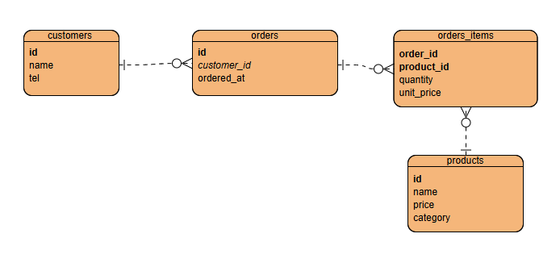

# 쇼핑몰 ERD 설계서
 
## 1. 엔터티 정의
| 엔터티 | 무엇을 담나 | PK |
|---|---|---|
| customers | 회원 기본 정보 | id |
| products | 판매 상품 | id |
| orders | 주문 한 건 | id |
| order_items | 주문에 담긴 상품 | (order_id, product_id) |

## 2. 관계
- customers 1 : N orders  — 회원 한 명이 여러 번 주문한다
- orders 1 : N order_items — 주문 하나에 상품이 여러 개 담긴다
- products 1 : N order_items — 상품 하나가 여러 주문에 담긴다
- (orders N : M products를 order_items로 풀었다)
 
## 3. 정규화 근거
- 고객 정보를 orders에서 분리한 이유: 전화번호 변경 시 한 곳만 고치기 위해 (갱신 이상 방지)
- 상품 목록을 한 칸에 담지 않은 이유: 1NF 위반 시 집계·인덱스가 불가능
 
## 4. 반정규화 결정
- order_items.unit_price를 둔 이유: 주문 당시 가격을 보존해야 한다
- 어긋남 방지: 주문 생성 시점에만 기록하고 이후 갱신하지 않는다
 
## 5. 확인한 것
- 없는 고객으로 주문 INSERT → 1452 오류로 차단됨
- 주문이 있는 고객 DELETE → 1451 오류로 차단됨

## DDL 쿼리
```sql
CREATE TABLE products (
  id       INT AUTO_INCREMENT PRIMARY KEY,
  name     VARCHAR(100) NOT NULL,
  category VARCHAR(50)  NOT NULL,
  price    INT          NOT NULL,
  stock    INT          NOT NULL DEFAULT 0
);

CREATE TABLE customers (
  id   INT AUTO_INCREMENT PRIMARY KEY,
  name VARCHAR(50) NOT NULL,
  tel  VARCHAR(20) NOT NULL
);
 
CREATE TABLE orders (
  id          INT AUTO_INCREMENT PRIMARY KEY,
  customer_id INT NOT NULL,
  ordered_at  DATETIME NOT NULL,
  CONSTRAINT fk_orders_customer
    FOREIGN KEY (customer_id) REFERENCES customers (id)
);
 
CREATE TABLE order_items (
  order_id   INT NOT NULL,
  product_id INT NOT NULL,
  quantity   INT NOT NULL,
  unit_price INT NOT NULL,   -- 주문 시점 가격 (의도된 반정규화)
  PRIMARY KEY (order_id, product_id),
  CONSTRAINT fk_items_order   FOREIGN KEY (order_id)   REFERENCES orders (id),
  CONSTRAINT fk_items_product FOREIGN KEY (product_id) REFERENCES products (id)
);
```

## ERD 설계



